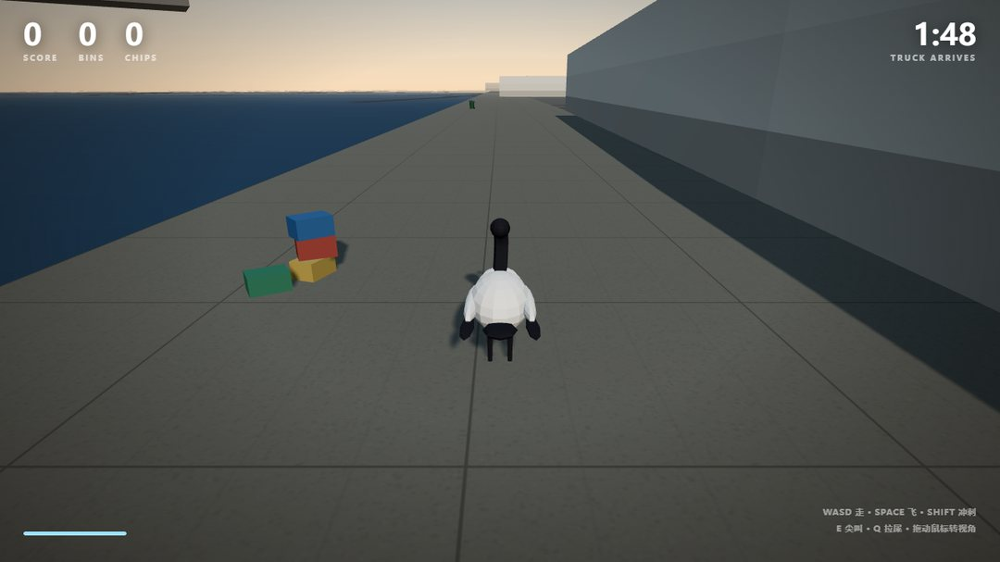
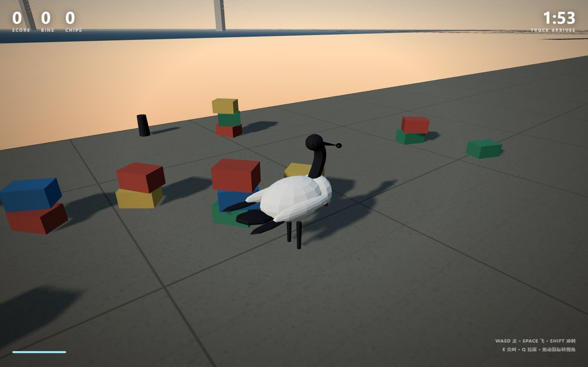
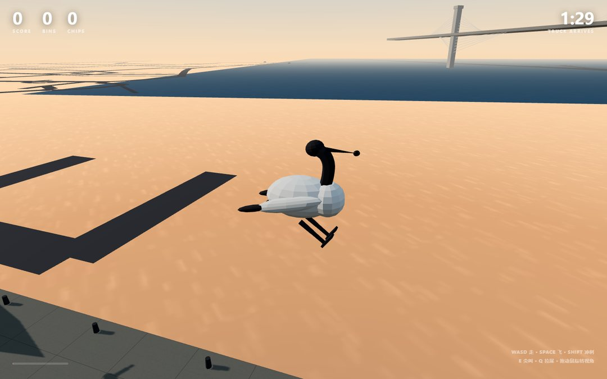

# BIN CHICKEN

**A bin-chicken simulator set on the real Sydney Fish Market.**

One self-contained HTML file. No build step, no server, no network. Double-click and play.



## Play

Open `index.html`. That is the whole install.

You get **2:00** before the garbage truck arrives. Sprint into wheelie bins, eat whatever falls out, and keep the seagulls off your chips.

| Input | Action |
|---|---|
| `WASD` | Waddle |
| `Shift` | Sprint — faster, and much more undignified |
| `Space` | Take off. Hold in the air to climb; wing energy drains and refills on the ground |
| `E` | Squawk — pops bin lids within 7 m without touching them |
| `Q` | Poop. No points. Only satisfaction. |
| Mouse drag | Orbit camera |
| Scroll | Zoom |



## The map is real

Nothing here is hand-placed. Building footprints and road centrelines come from
OpenStreetMap via the Overpass API — **247 buildings and 815 road segments**
around Blackwattle Bay, projected to metres and extruded at load.

The fish market is the real 148 × 90 m slab. The wharf follows the real shoreline.
Anzac Bridge sits where it actually does.

`geo/` holds the pipeline:

```
geo/convert.mjs        Overpass JSON  ->  local metre coordinates
geo/gen.mjs            local metres   ->  mapdata.min.json (what the game reads)
geo/mapdata.min.json   247 buildings + 815 roads + coastline
```

`osm_raw.json` (the 1.3 MB raw Overpass dump) is not committed — the query that
produces it is at the top of `convert.mjs`.

## How it is built

- **three.js r160**, inlined and converted from ESM to a classic script: the
  `export { A as B }` list is rewritten to `window.THREE = { B: A }` and wrapped
  in an IIFE. Result: zero external requests, no CORS, runs straight from `file://`.
- **No assets.** Ground and wharf textures are drawn on a canvas at runtime,
  every sound is synthesised with WebAudio, and the bird is spheres, cones and
  cylinders.
- One merged geometry for the whole city — roughly 24k triangles, one draw call.



## Known gaps

This is a 15-second prototype, not a game yet.

- The bird reads as an ibis from the side and as a shuttlecock from directly behind.
- Water is a flat plane. No waves, no reflection.
- The market is exterior only — you cannot go inside.
- No people, which is the biggest missing comedy source: a fish market full of
  tourists and a bird that steals their chips writes itself.
- Fish crates are decoration and have no collision.

## Credits

Map data © [OpenStreetMap](https://www.openstreetmap.org/copyright) contributors, ODbL.
three.js — MIT.
